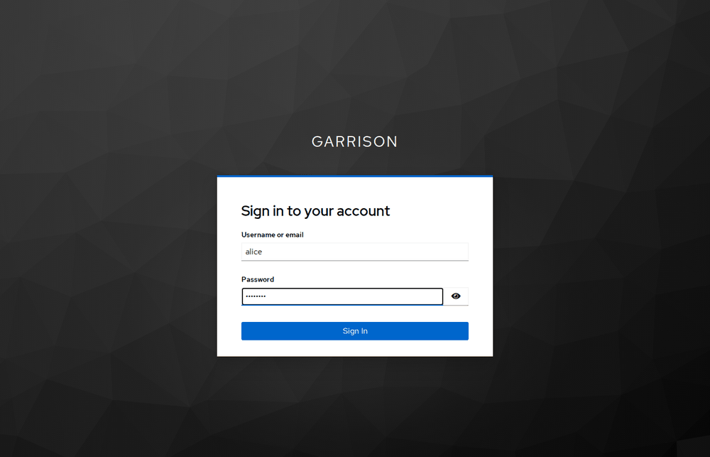
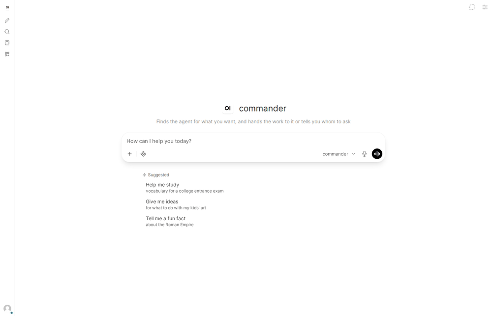
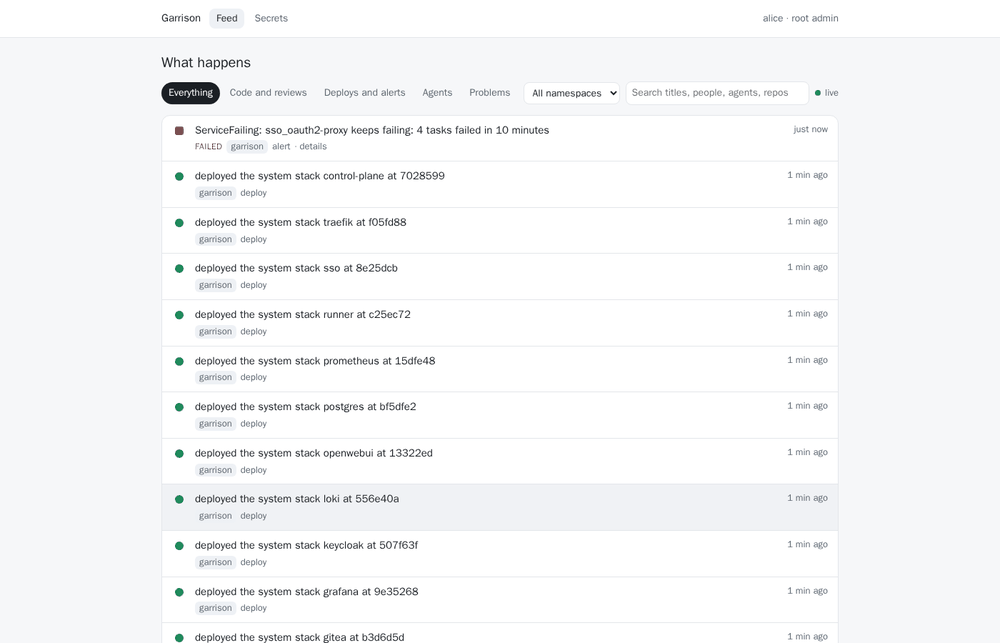

# 2. Signing in

Everyone has one account, in Keycloak. It signs them in to every part of
Garrison: the dashboard, Gitea and the chat. After signing in once, the
other apps don't ask for the password again.

| Address | What it is |
| --- | --- |
| `https://garrison.test` | The dashboard: what waits for you, what happened, secrets |
| `https://chat.garrison.test` | Open WebUI: a channel per unit, where you talk to the agents |
| `https://git.garrison.test` | Gitea: the repos, and every change as a pull request |

alice opens Gitea and picks "Sign in with Keycloak". Keycloak's form asks for
her name and password:

The chat then opens without asking again. Its sidebar lists the channels of
the units she belongs to; `garrison` is everyone's:

So does the dashboard. Its page shows what waits for her, such as changes
to approve and questions from the agents, and what happened lately:

Next: [3. A unit](03-unit.md)
