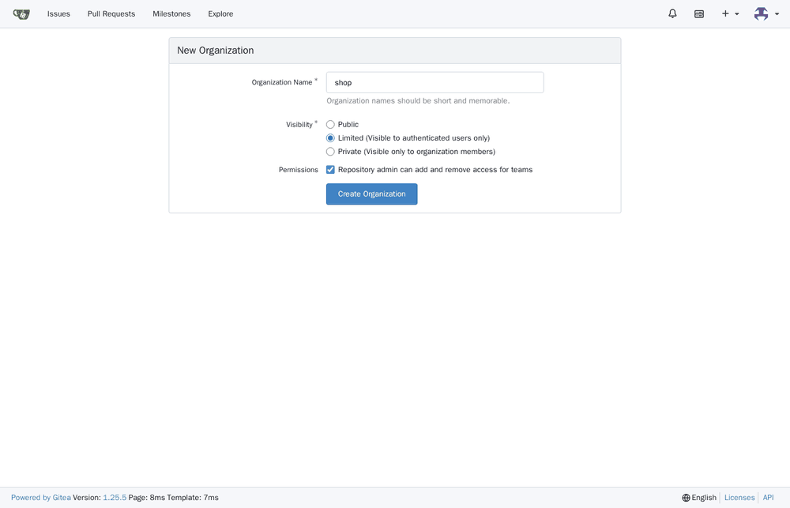
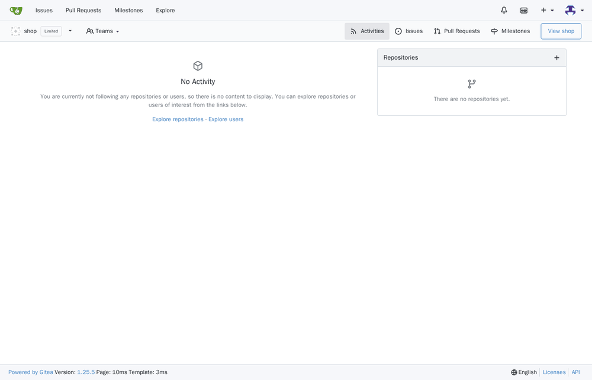
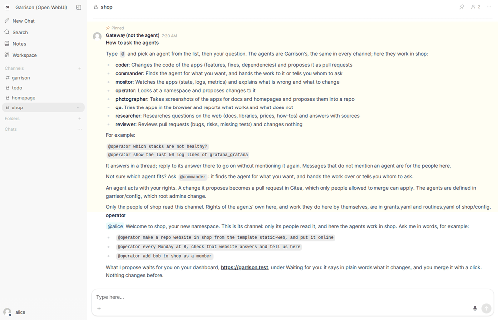
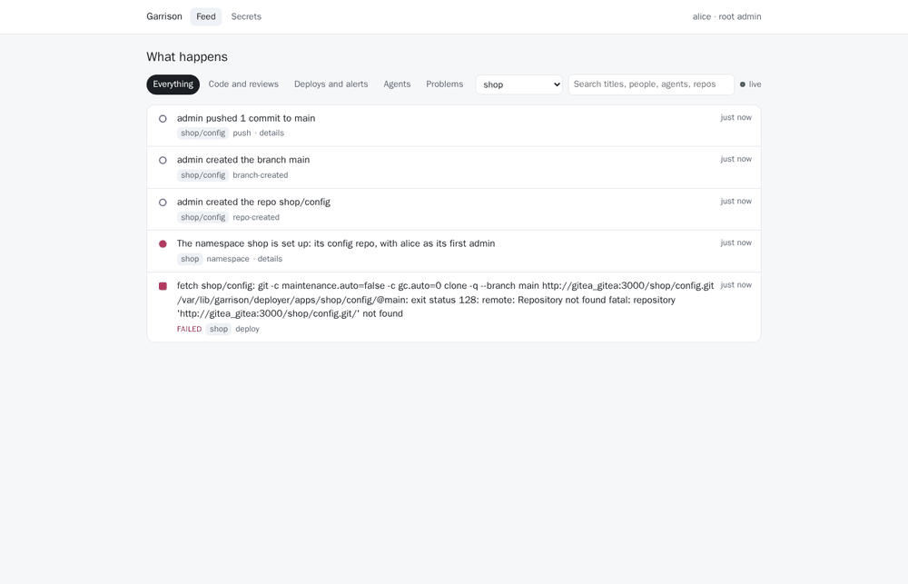
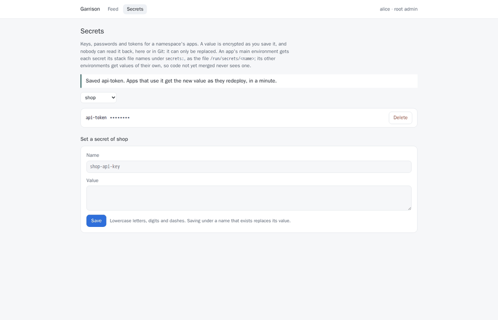

# 3. A namespace

A namespace is a group of apps, with its own people, its own chat channel
and its own settings. In Gitea it is an organisation. alice makes one
called `shop`.

## Making it

alice can make it in Gitea's New Organisation form, or ask in the chat
(`@operator make a namespace shop`). Here she uses the form:

Within seconds, Garrison sets it up:

- the repo `shop/config`, which holds everything about the namespace: who
  belongs to it (`members.yaml`), its apps (`stacks/`), what the agents may
  do (`grants.yaml`) and do by themselves (`routines.yaml`), and its
  secrets, encrypted;
- alice as its first admin;
- a channel `shop` in the chat, which only shop's people see.

## Its channel

In the new channel the operator welcomes alice. It gives examples of what to
ask, and says where its proposals wait for her:

Her dashboard says the namespace is set up:

## A secret

Apps often need a password or a token. alice saves `api-token` on the
dashboard's Secrets page. The page lists its name and never shows its value
again. In `shop/config` it is stored encrypted, so it can be in Git; only
the machine can read it.

Next: [4. An app and its stack](04-app-and-stack.md)
