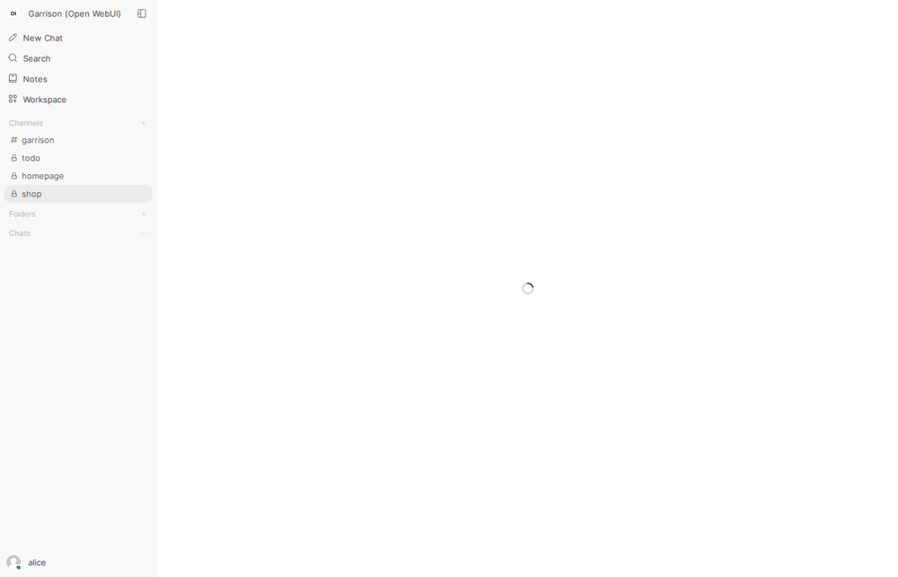
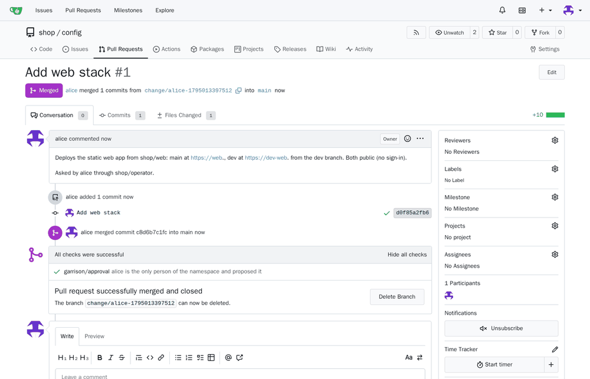
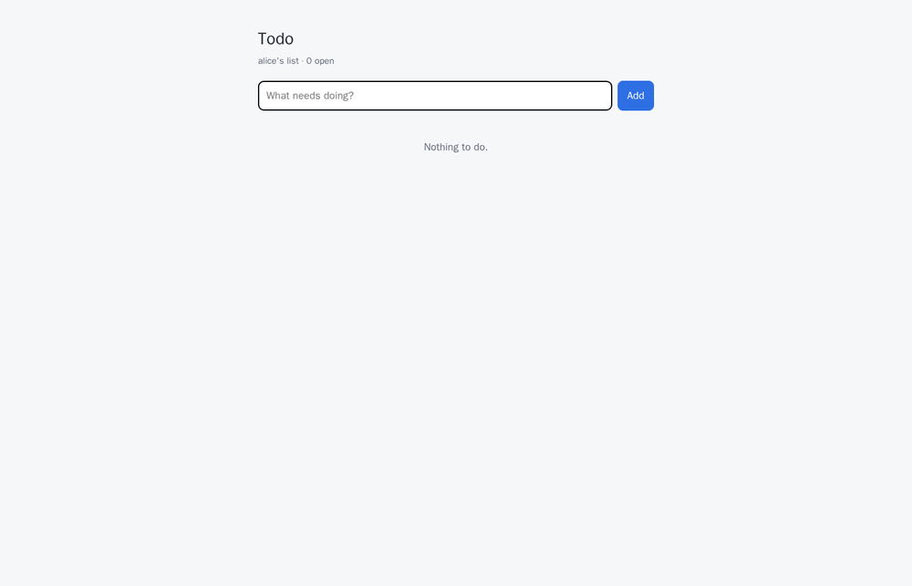

# 4. An app and its stack

alice wants a small web page online. She asks the operator for it in shop's
channel. The operator makes a repo with the page's code, and proposes how
to run it. Nothing goes live until she merges.

## Asking

In shop's channel she types `@`, picks `operator` from the list, and asks:

> @operator Make the repo web in shop from the template static-web, then
> propose its stack stacks/web.yaml in shop/config as its README says,
> with the environments main and dev, both public.

The operator answers in a thread. It made the repo `shop/web` from the
template `static-web`. That repo has the page, a Dockerfile and a pipeline
that builds an image on every push. The operator also proposed the *stack*
`stacks/web.yaml`, which says how the app runs: its image, its port, and its
environments. Its answer links the change on her dashboard:

## The change, in plain words

The link opens the change's page on the dashboard. The page says in plain
words what merging does: here, it deploys the app web. alice is shop's only
person, so her own change needs nobody else's approval:

When someone else proposed a change, the page offers **Approve and merge**:
one click approves it and merges it as soon as Gitea's checks allow.

The same change is a pull request in Gitea, where it can also be merged:

## Live

Once it is merged, the deployer runs the app. A few minutes later the page
is at `https://web.garrison.test`. The operator says so in shop's channel,
with the address.

Next: [5. A dev environment](05-dev-environment.md)
