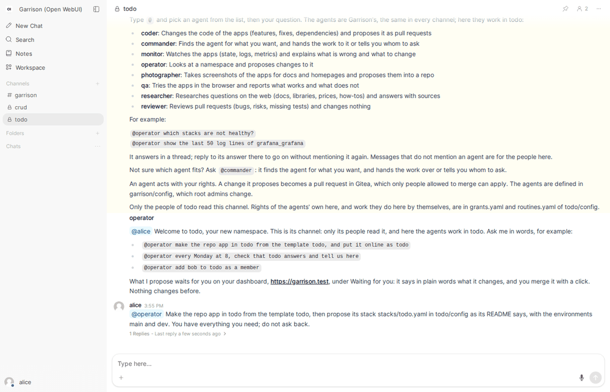
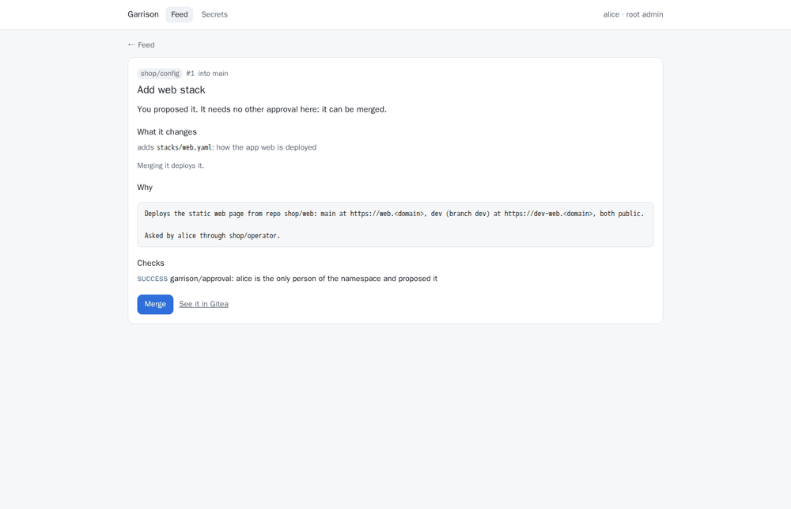

# 4. An app and its stack

alice wants a todo list for her team online. She asks the operator for it
in todo's channel. The operator makes a repo with the app's code, from
Garrison's template `todo`, and proposes how to run it. Nothing goes live
until she merges.

## Asking

In todo's channel she types `@`, picks `operator` from the list, and asks:

> @operator Make the repo app in todo from the template todo, then
> propose its stack stacks/todo.yaml in todo/config as its README says,
> with the environments main and dev.

The operator answers in a thread. It made the repo `todo/app` from the
template `todo`. That repo has the app (`main.go`, `page.html`), its tests,
a Dockerfile and a pipeline that tests the code and builds an image on every
push; a failing test means no image, so the app keeps running as it was.
The operator also proposed the *stack* `stacks/todo.yaml`, which says how
the app runs: its image and its database, the environments, and that they
are behind the sign-in. The file's name is the app's address,
`todo.garrison.test`. Its answer links the change on her dashboard:

## The change, in plain words

The link opens the change's page on the dashboard. The page says in plain
words what merging does: here, it deploys the app todo. alice is todo's only
person, so her own change needs nobody else's approval:

When someone else proposed a change, the page offers **Approve and merge**:
one click approves it and merges it as soon as Gitea's checks allow.

The same change is a pull request in Gitea, where it can also be merged:

## Live

Once it is merged, the deployer runs the app and its database. A few
minutes later it is at `https://todo.garrison.test`, behind the sign-in:
alice is signed in already, and sees her own list. Everyone signed in has a
list of their own there. The operator says so in todo's channel, with the
address.

Next: [5. A dev environment](05-dev-environment.md)
