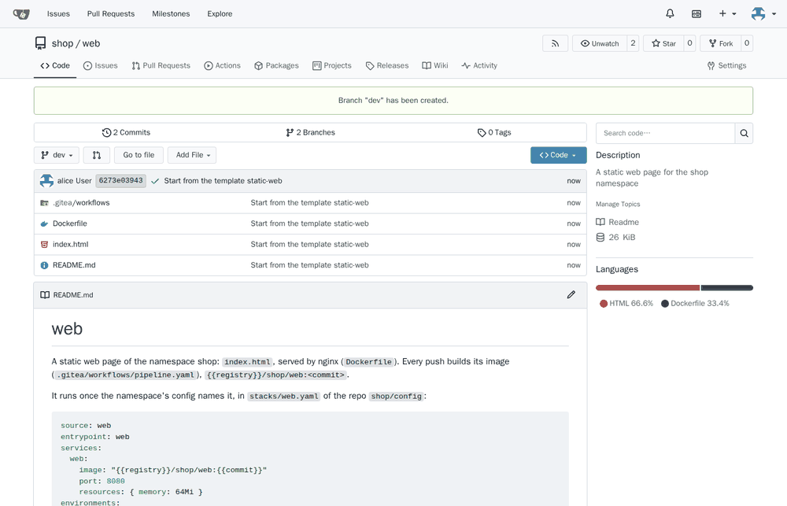
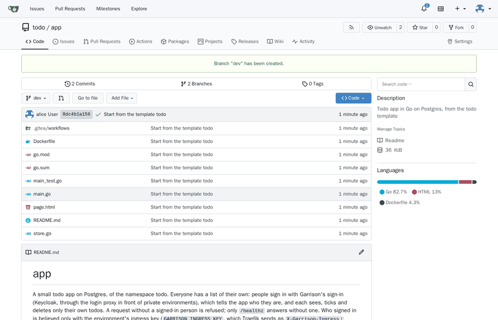
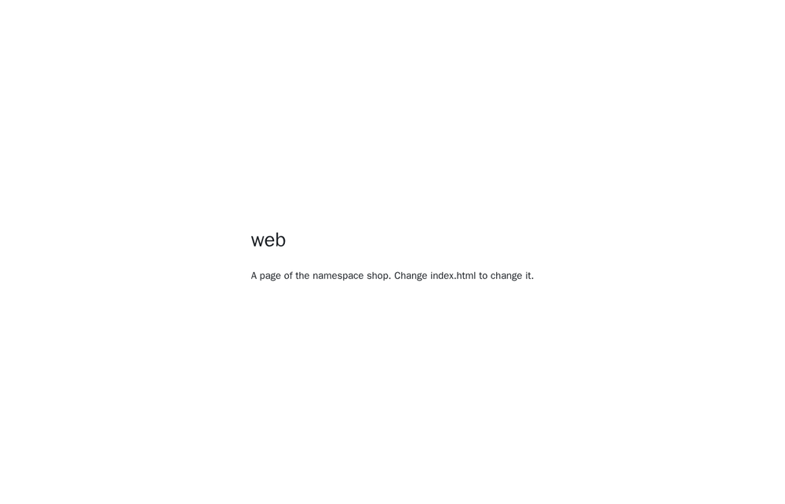
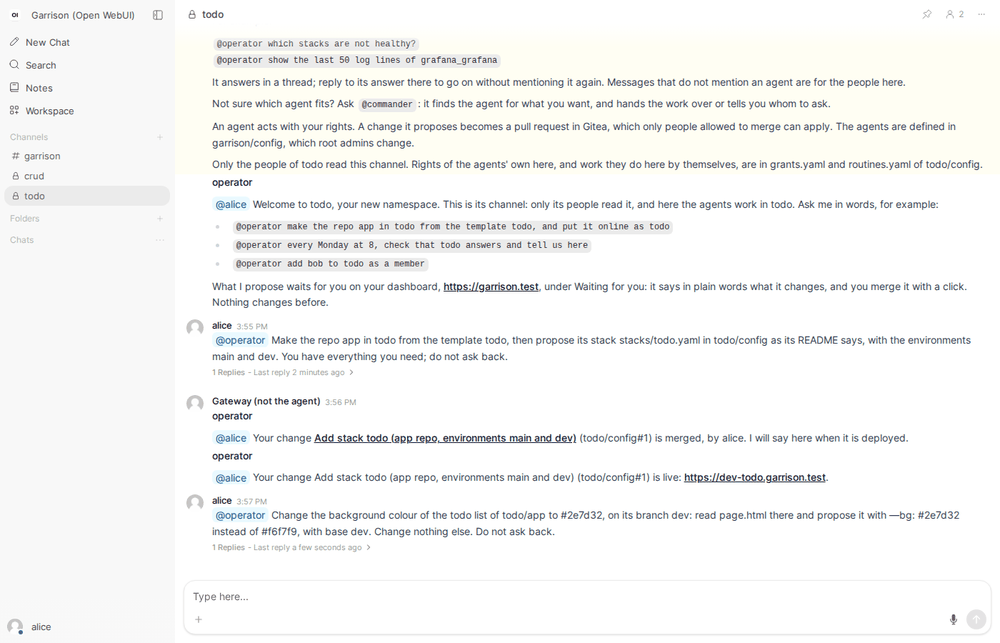
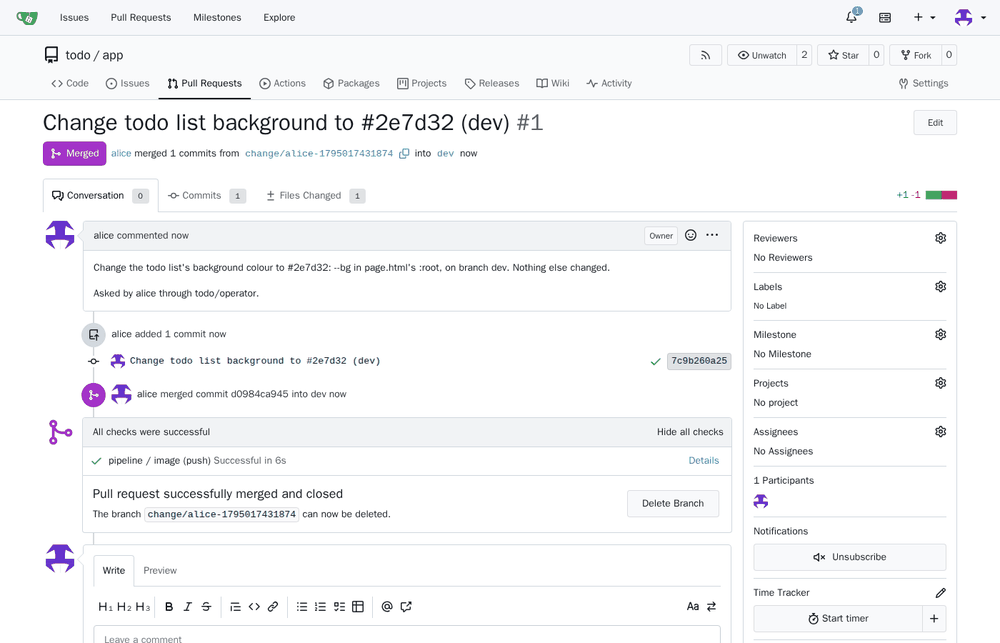
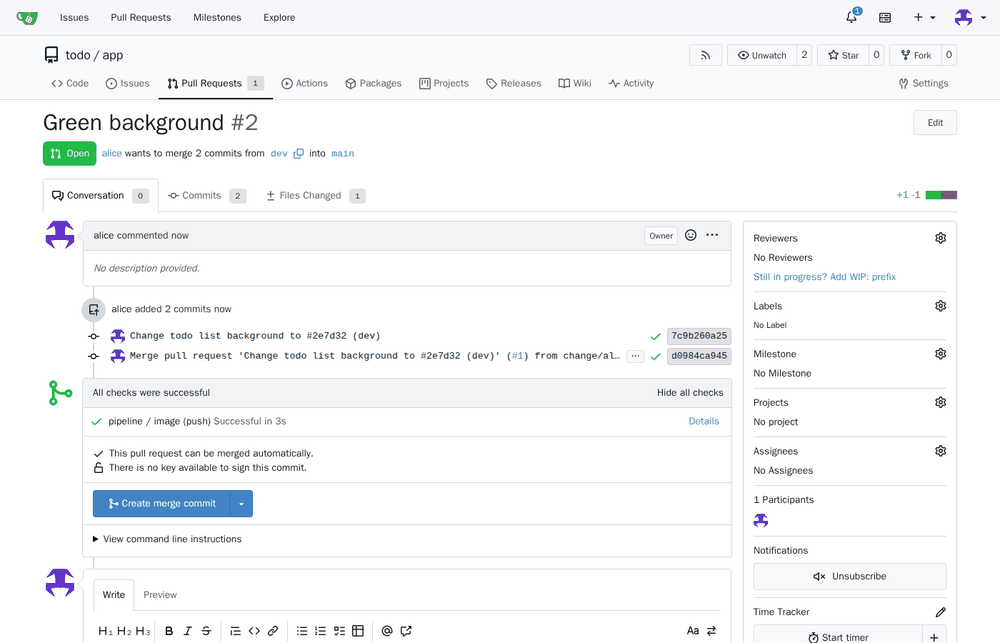
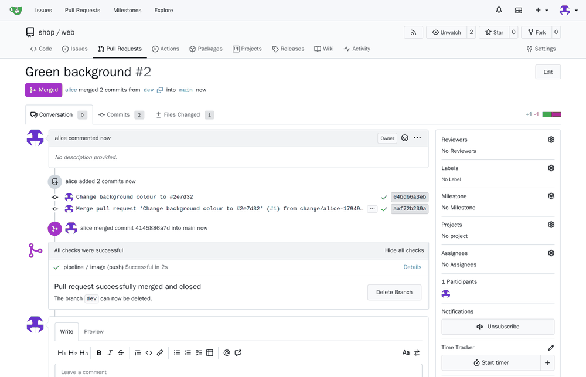
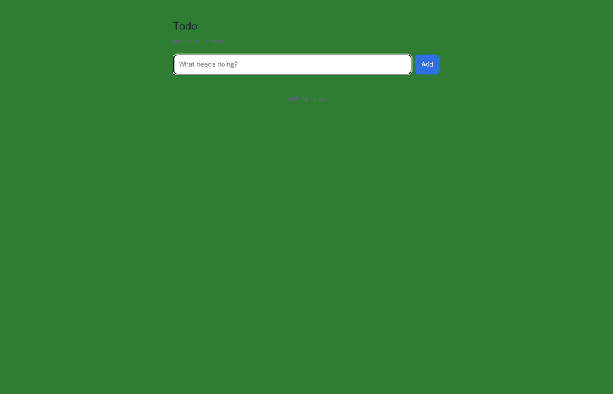

# 5. A dev environment

The stack named two environments, `main` and `dev`. Each is a branch of the
app's repo, and runs as its own copy of the app: `main` at
`https://web.garrison.test`, `dev` at `https://dev-web.garrison.test`.
Changes go to dev first. When they look right, dev is merged into main.

## The branch

alice makes the branch `dev` in Gitea's branch list. Nobody has to merge
anything for it: the stack names dev already. The image of that commit was
built for main, so `dev-web` comes up within a minute.

## A change on dev

She asks the operator for a green background, on dev only:

> @operator Change the background colour of the page of shop/web to
> #2e7d32, on its branch dev. Change nothing else.

It proposes a pull request into `dev` that changes `index.html` only. She
merges it. The pipeline builds the new image, and dev-web turns green, while
web, on main, stays white.

## dev into main

In Gitea she compares dev with main, opens the pull request "Green
background" and merges it. web turns green too.

Next: [6. The agents at work](06-agents.md)
