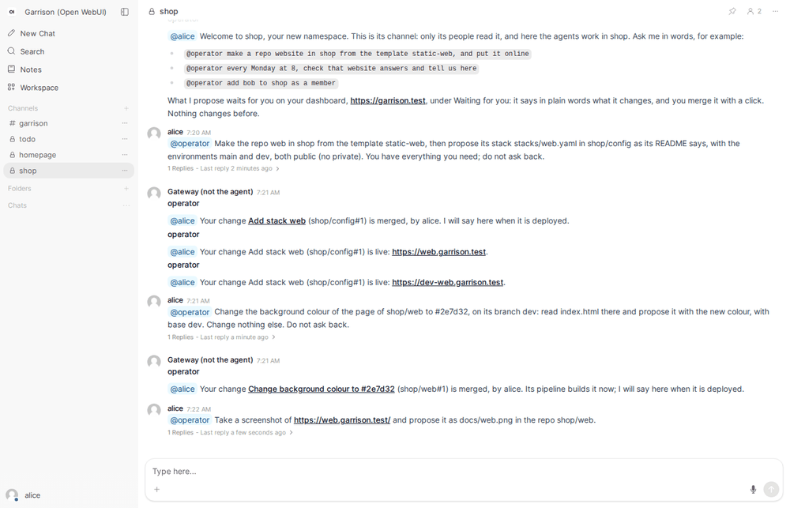
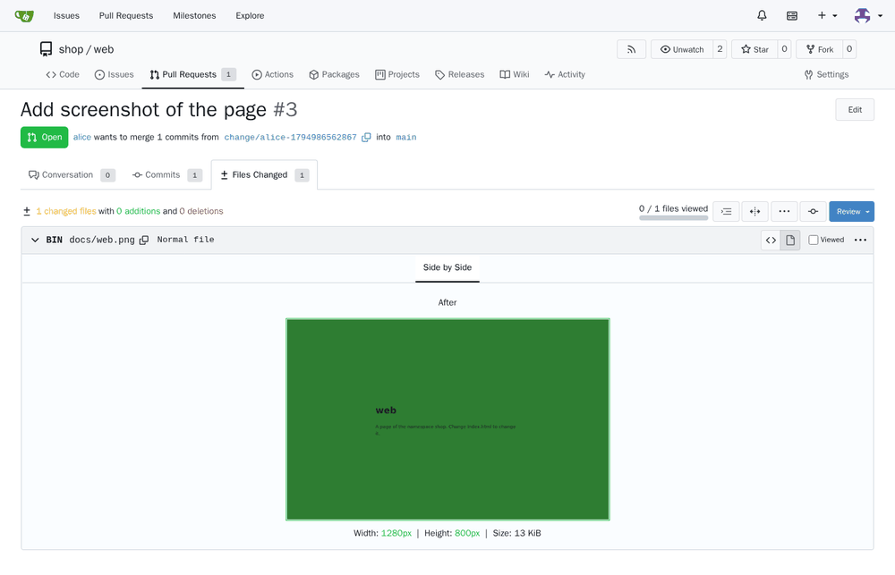

# 6. The agents at work

The agents are the same in every channel; in a namespace's channel they
work in that namespace. The channel's pinned message lists them: the
operator runs namespaces and apps, the coder changes code, the browser
tries apps and takes screenshots, the reviewer reviews pull requests, the monitor watches
apps, and so on. An agent acts with the rights of the person asking. What
it changes is a pull request, which only people allowed to merge can apply.

## A screenshot for the repo

alice asks the operator for a screenshot of the app, for the repo's docs:

> @operator Take a screenshot of https://todo.garrison.test/ and propose it
> as docs/todo.png in the repo todo/app.

The agent opens the app in a browser in its sandbox, signed in as itself, and proposes the image
as a pull request. Gitea shows it in the files changed:

## Not sure whom to ask?

`@commander` finds the agent for what you want. It hands the work over, or
tells you whom to ask. bob asks it who changes the todo app:

Next: [7. A second person](07-members.md)
