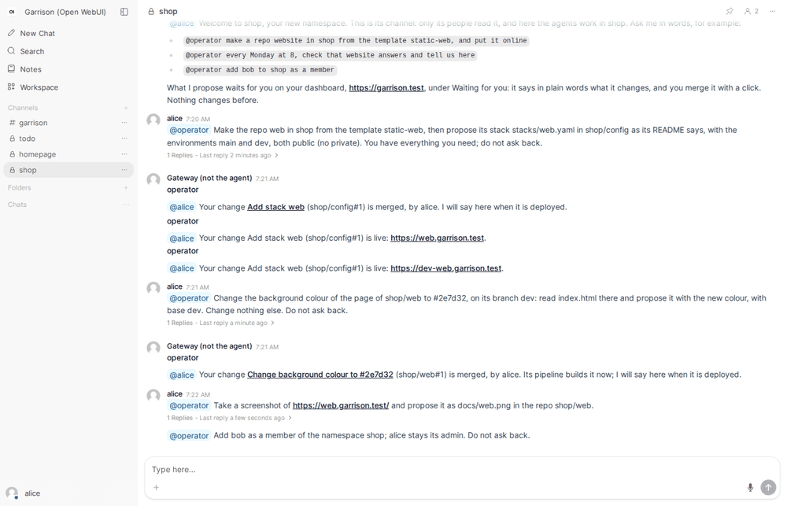
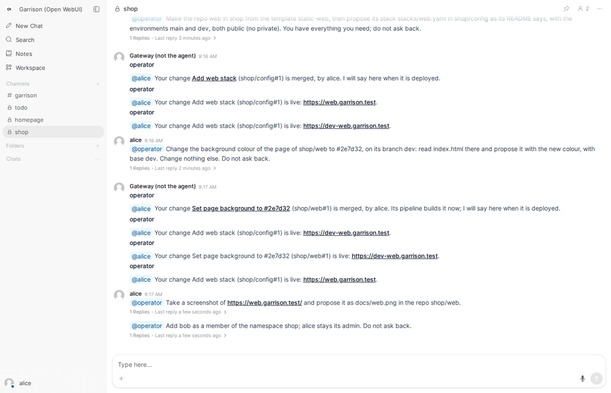
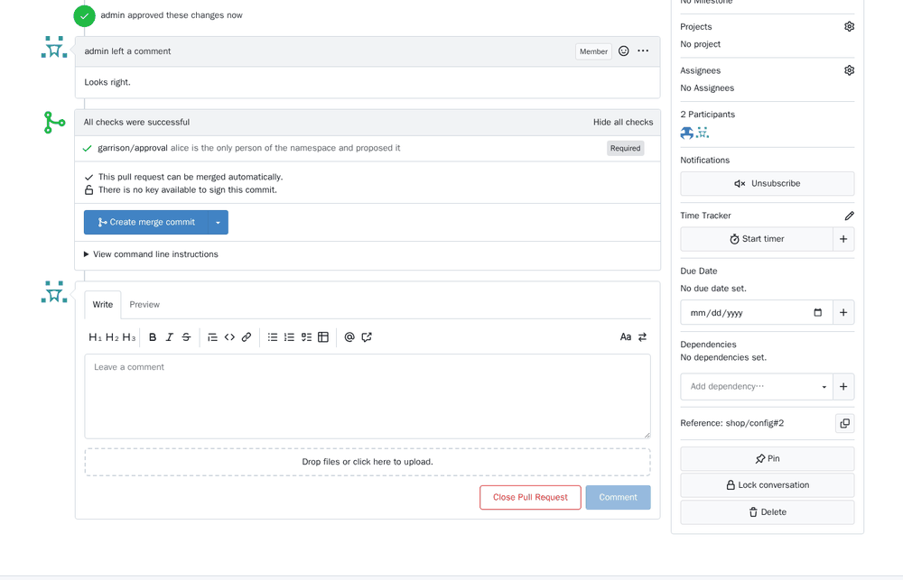
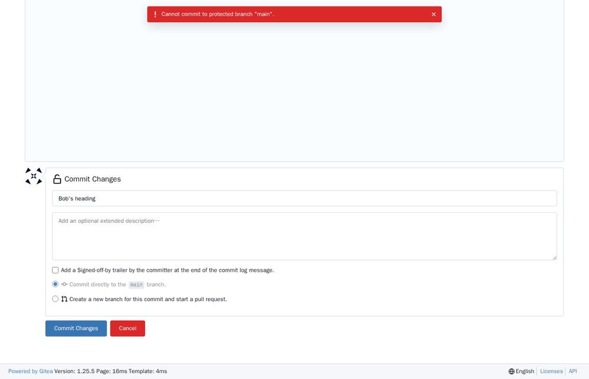
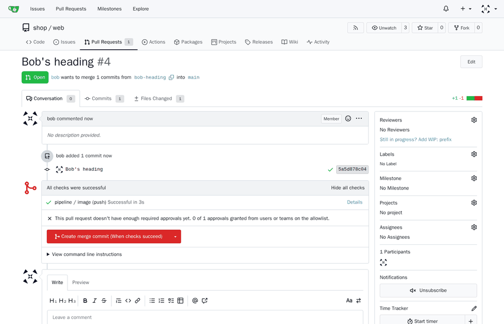
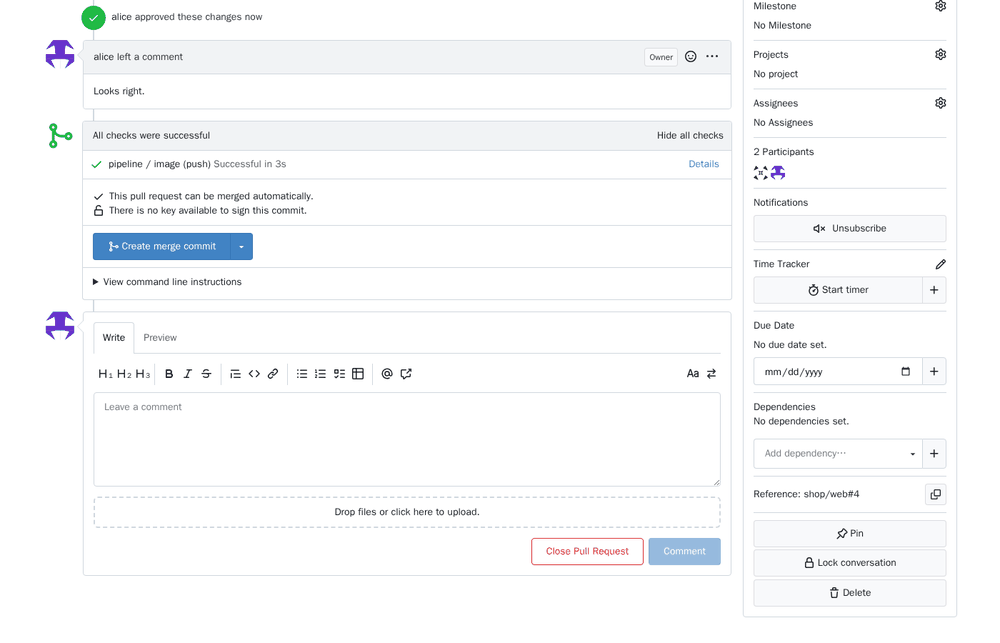
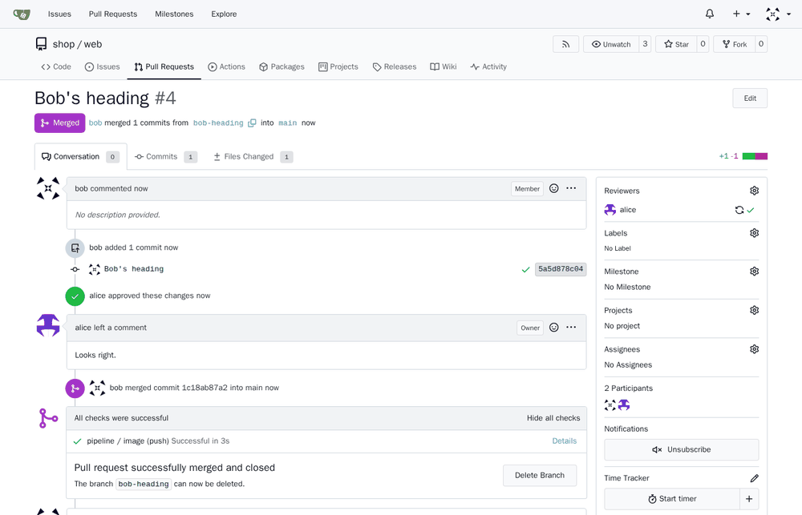

# 7. A second person

Who belongs to a namespace is in `members.yaml` of its config: its admins
and its members. A change to it is a pull request like any other. alice asks
the operator to add bob.

## Adding bob

> @operator Add bob as a member of the namespace shop; alice stays its admin.

alice is still shop's only person, so her own change needs nobody else's
approval; here a root admin approves it too. Then alice merges it, and
within a minute bob sees shop's channel.

## Now main takes only approved changes

While alice was shop's only person, she could change main freely. With two
people, main of shop's apps takes only pull requests that someone other
than their author approved.

bob edits `index.html` straight on main in Gitea's editor, and Gitea refuses
it:

He commits it to a new branch instead and opens a pull request. Its page
offers him no merge until alice approves it:

Then bob merges it, and web shows his heading.

Next: [8. Routines: agents on a schedule](08-routines.md)
