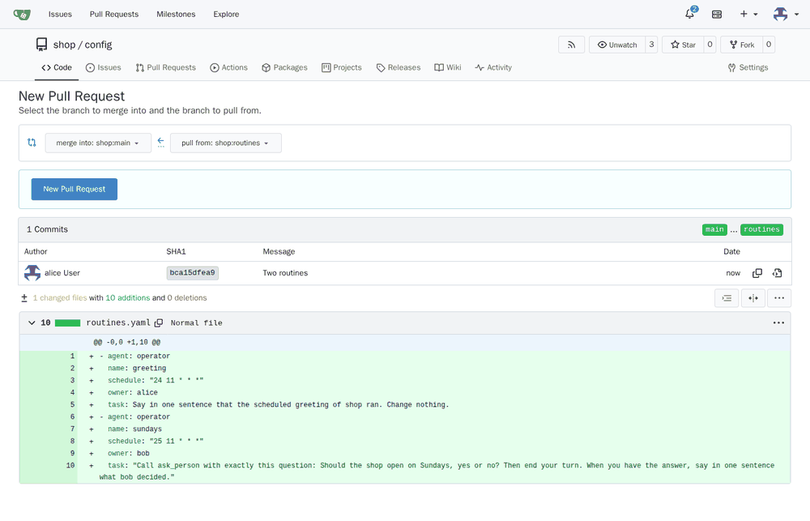
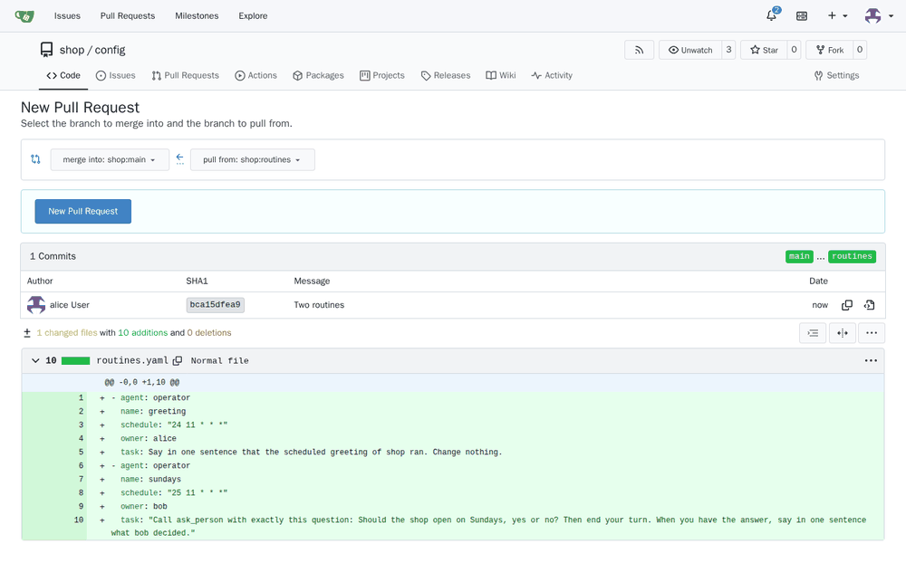
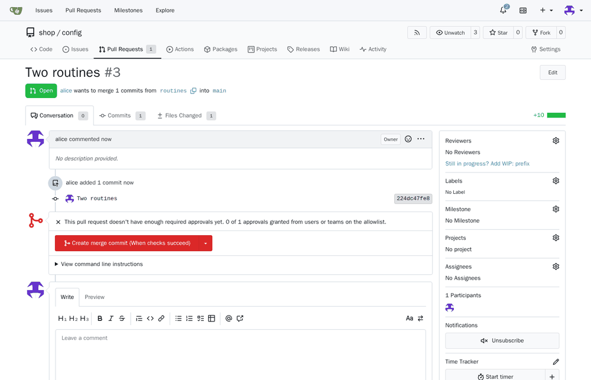
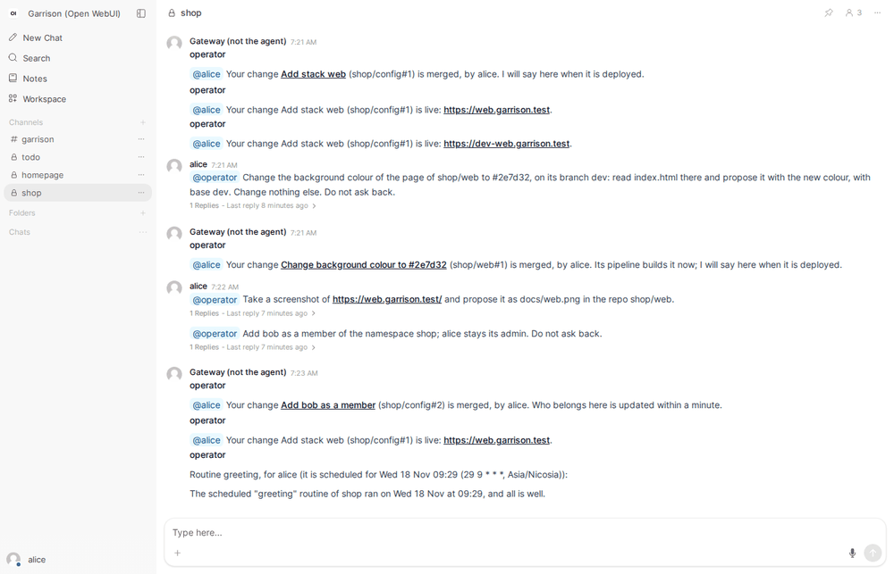
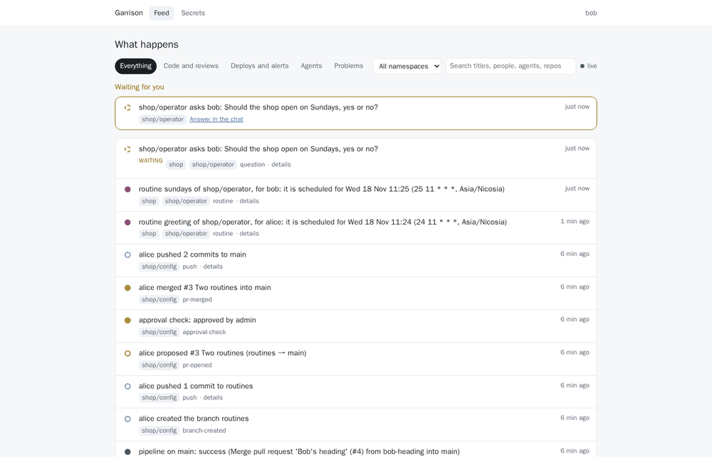
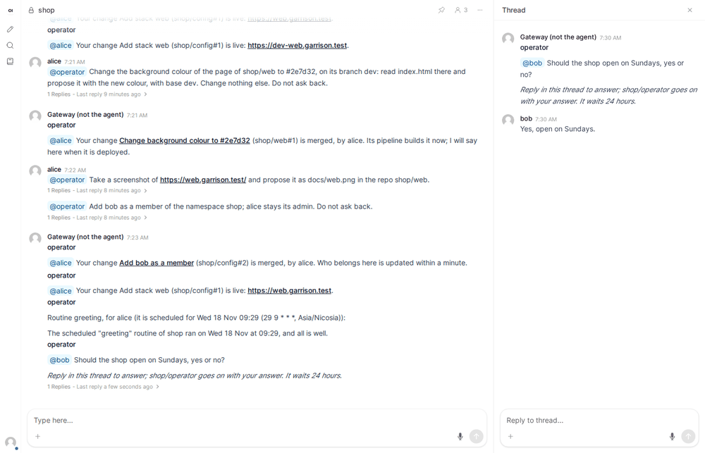
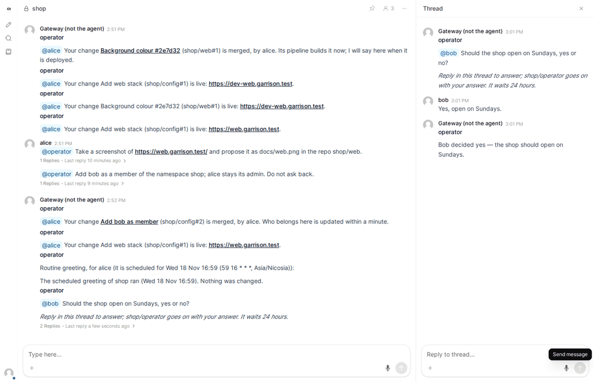

# 8. Routines: agents on a schedule

A routine is work an agent does by itself, on a schedule, such as "every
Monday at 8, check the website answers and tell us". Routines are listed in
`routines.yaml` of the namespace's config. Like everything there, a new
routine is a pull request, and nothing runs until it is merged. What a
routine finds is posted in the namespace's channel.



## Asking for one

The simplest way is to ask in the channel:

> @operator every day at 9, check that web answers and tell us here

The operator writes the routine into `routines.yaml` and opens a pull
request, owned by you. If the routine changes a repo, the same pull request
gives the agent the right it needs for that, in `grants.yaml`. Merge it,
and the routine runs from then on.

## Writing them in Gitea

`routines.yaml` can also be edited by hand. In the browser test, alice adds
two routines in Gitea's editor, on a new branch. `schedule` is a cron
schedule, in the installation's time zone; `every: 6h` works too:

```yaml
- agent: operator
  name: greeting
  schedule: "0 9 * * *"
  owner: alice
  task: Say in one sentence that the scheduled greeting of shop ran. Change nothing.
- agent: operator
  name: sundays
  schedule: "5 9 * * *"
  owner: bob
  task: "Call ask_person with exactly this question: Should the shop open on Sundays, yes or no? Then end your turn. When you have the answer, say in one sentence what bob decided."
```



She proposes it as a pull request. Once it is approved, she merges it:



At its time, the greeting is posted in shop's channel:



## A routine that asks

The second routine needs a decision from bob, so it asks him in the
channel. The question waits for him on his dashboard, under **Waiting for
you**:



The link opens the question's thread, where he answers:



The routine then goes on with his answer, in the same thread:



Next: [9. Scheduled jobs](09-scheduled-jobs.md)
