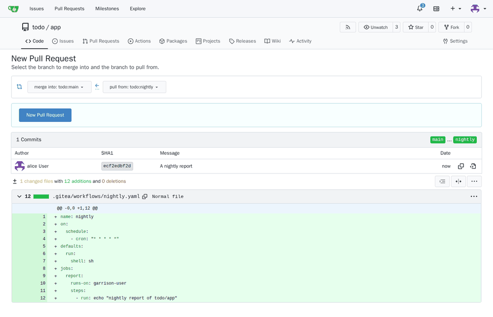
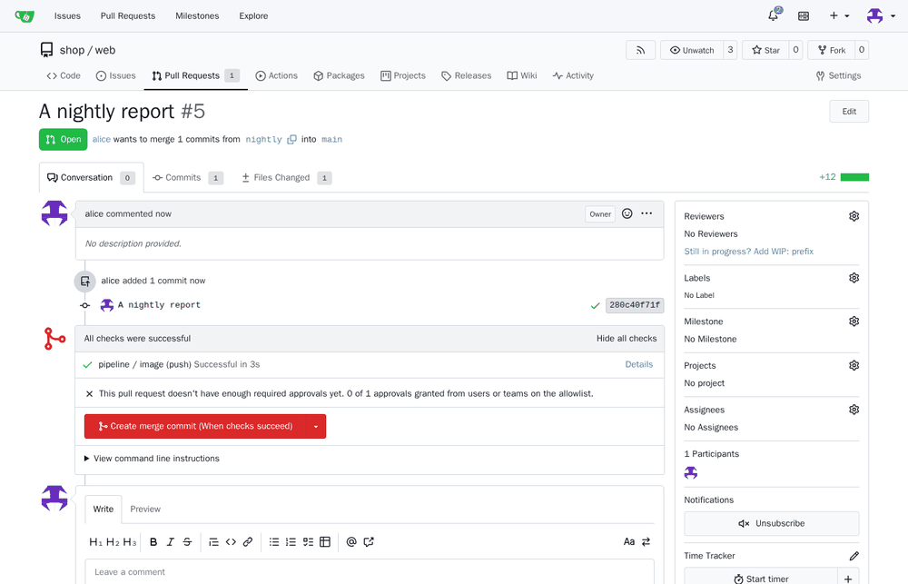
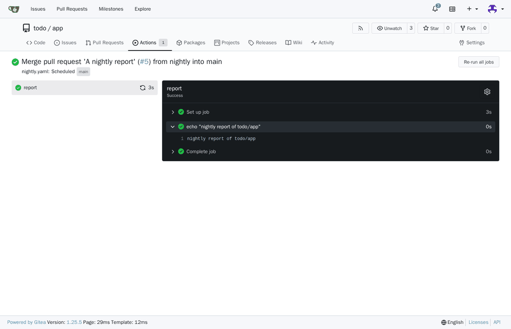
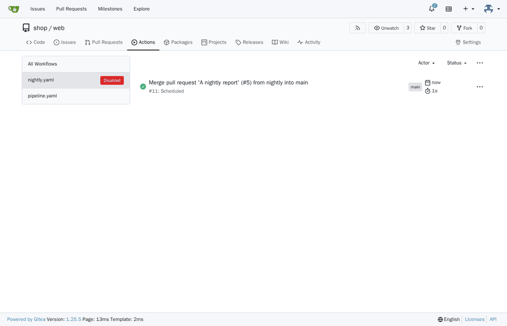

# 9. Scheduled jobs

Not everything needs an agent. A plain cron job of an app is a Gitea Actions
workflow in the app's repo, on a `schedule`. It runs on the unit's own
runner, with no LLM involved. Use it for backups, reports, or cleaning up.

## Adding it

alice adds `.gitea/workflows/nightly.yaml` to `todo/app` in Gitea's editor,
on a new branch:

```yaml
name: nightly
on:
  schedule:
    - cron: "0 3 * * *"     # every night at 3; the test uses "* * * * *"
defaults:
  run:
    shell: sh
jobs:
  report:
    runs-on: garrison-user  # todo's runner
    steps:
      - run: echo "nightly report of todo/app"
```



todo has two people now, so main takes it only as an approved pull request.
bob approves it, and alice merges it:



## Its runs

At its time, the repo's Actions tab lists a run started by the schedule,
with the job's output in its log:



The tab's menu disables the workflow, and then it runs no more:



Back to the [walkthrough](README.md).
